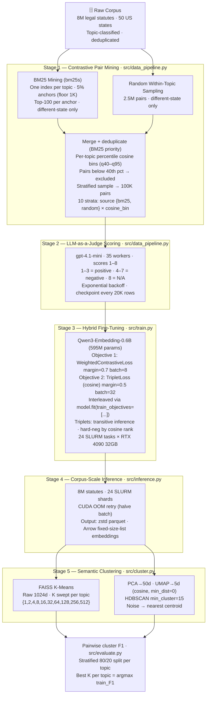

# Legal Statute Representation Learning at Scale


**Developed a domain-specific representation-learning pipeline for semantic grouping across approximately 8 million legal statutes.** Combined BM25 and embedding-based candidate mining, LLM-judged similarity labels, contrastive/triplet fine-tuning of `Qwen3-Embedding-0.6B`, and FAISS K-Means/HDBSCAN clustering. Historical evaluation on held-out labeled pairs showed **+0.20 mean F1** versus the base model (see [Results](#results)).

---


## Results

> **Historical proprietary-corpus results.** These figures are not reproducible from the public synthetic fixtures and must not be compared with the demo outputs.

| Model | Same-cluster pairwise F1 | Notes |
|---|---|---|
| `Qwen3-Embedding-0.6B` (base) | 0.61 | Zero-shot, no fine-tuning |
| `Qwen3-Embedding-0.6B` (fine-tuned) | **0.81** | Fine-tuned with contrastive + triplet loss |
| **Δ improvement** | **+0.20** | On held-out labeled pairs, proprietary corpus |

**How the +0.20 was measured:** The +0.20 F1 figure in the table above is the mean test-split F1 across topics for the fine-tuned model minus the same for the base model, each at their per-topic best-K, evaluated on the proprietary corpus. Similarity was predicted from shared K-Means cluster membership, not a cosine threshold. See [Evaluation protocol](#evaluation-protocol).

### Embedding similarity before and after fine-tuning

Two representative topics from the proprietary corpus:

| Health | Government Operations |
|:---:|:---:|
|  |  |

Filled = before fine-tuning; dashed = after. Green = positive pairs (similar statutes), red = negative pairs (dissimilar). After training the distributions separate cleanly — positives shift right toward cosine ≈ 0.9 and negatives shift left toward ≈ 0.0. `train.py` generates an equivalent plot for any run at `runs/<name>/task_00/visualization/cosine_kde.png`.

---

## Pipeline at a glance



The original pipeline mined approximately 100K labeled pairs, trained with weighted contrastive and triplet objectives, and produced embeddings over the full corpus using 24 Slurm inference shards. The public modules illustrate these stages; the proprietary data and full infrastructure are not included.

---

## 🔬 Architecture Deep Dive

### 1. Candidate mining and LLM supervision

Naïve random sampling produces easy negatives that carry weak training signal.
The pipeline mines **hard negatives** — statutes that are lexically similar but
semantically distinct — using `bm25s` BM25 retrieval per topic.

```
For each topic domain T:
  anchors ← sample(members_T, frac=max(0.05, floor=1000))
  For each anchor a (different-state pairs only):
    candidates ← bm25s_index_T.top_k(a, k=100)

2.5M random within-topic pairs (different-state only)

Merge + deduplicate (BM25 priority)

cosine_scores ← base_model.encode(all_pairs)
Per-topic percentile bins (thresholds computed within each topic):
  q40_60 | q60_80 | q80_90 | q90_95 | q95_100
  Pairs below 40th percentile of their topic → excluded

Stratified sample → 100K pairs
  strata = source {bm25, random} × cosine_bin {q40_60…q95_100} = 10 cells
```

Key design decisions:
- **Same-state exclusion**: statutes from the same US state share drafting conventions and often reuse near-identical boilerplate, making same-state pairs trivially similar regardless of topic. Discarding them forces the model to learn substantive semantic similarity rather than stylistic overlap.
- **Per-topic percentile bins**: cosine similarity distributions vary substantially across policy domains — Health statutes cluster at higher baseline similarity than, say, Foreign Trade. Computing bin thresholds as percentiles *within* each topic ensures the same bin label (e.g. q80_90) captures comparably informative pairs across all topics, rather than systematically over- or under-sampling dense domains.
- **Stratified weight matrix**: BM25 retrieval biases toward lexically similar pairs, which tend to land in higher cosine bins. Left uncontrolled, the training set would be dominated by a single stratum. The weight matrix fixes the proportion of each (source, cosine_bin) cell in the final 100K pairs; weights were tuned on the proprietary corpus to balance coverage and informativeness.

---

### 2. Hybrid contrastive and triplet fine-tuning

Training uses two interleaved objectives via `model.fit(train_objectives=[...])`:

**Objective 1 — WeightedContrastiveLoss (margin = 0.7)**
```
L(a, b, y, w) = w × 0.5 × [y × d(a,b)²  +  (1-y) × max(0, margin − d(a,b))²]

where  d(a, b) = 1 − cos(a, b)   and   y ∈ {0, 1}
```
Per-score sampling multipliers `{1: 4.0, 2: 2.0, 3: 0.5, 4: 0.2, 5: 0.2, 6: 1.0, 7: 4.0}`
upweight hard/informative examples. Score 4 (boundary) is included as a hard
training negative with low weight; it is excluded from the evaluation metric.

**Objective 2 — TripletLoss (cosine distance, margin = 0.5)**
```
L(a, p, n) = max(0,  d(a, p)  −  d(a, n)  +  margin)

where  d(x, y) = 1 − cos(x, y)   and   margin = 0.5
```

**Triplet construction** uses transitive inference: if the scored pair table
establishes (A ↔ B) as positive and (A ↔ C) as negative, the triplet (A, B, C)
is valid without requiring a direct (B, C) judgment. This multiplies the effective
triplet count from the labeled pairs without additional API calls.

**Hard-negative selection**: within each anchor's negative pool, candidates are
sorted by descending cosine similarity — the most confusable negatives are
presented first, keeping gradients informative throughout training.

Both losses use the differentiable transformer forward pass to propagate gradients into the embedding model.

---


#### Training configuration

| Parameter | Value |
|---|---|
| Base model | `Qwen/Qwen3-Embedding-0.6B` |
| Embedding dimension | 1024 |
| Loss 1 | WeightedContrastiveLoss (cosine distance) |
| Contrastive margin | 0.7 |
| Contrastive batch size | 8 |
| Loss 2 | TripletLoss (cosine distance) |
| Triplet margin | 0.5 |
| Triplet batch size | 32 |
| Learning rate | 2e-5 |
| Epochs | 3 |
| Warmup steps | 100 |
| Optimizer | AdamW |
| Training pairs | ~100K labeled pairs → ~300K triplets |
| Hardware | 1× RTX 4090, 32 GB VRAM |
| HPC cluster | Institutional HPC cluster (SLURM array, 24 tasks) |

### 3. Semantic clustering

After fine-tuning, the full 8M-statute corpus is embedded in parallel across
24 SLURM shards. Two independent clustering pipelines are run on the resulting
embedding matrix:

**Approach 1 — FAISS K-Means** (`pipeline_kmeans`):
```
Raw 1024d embeddings  →  FAISS K-Means, K swept per topic
                          Best K per topic by pairwise F1 on held-out labels
```
- **No dimensionality reduction**: K-Means operates directly on the 1024d Qwen3 embeddings; the distances are already meaningful in that space
- Run **per topic domain** — one K-Means per primary policy topic; K is swept over `[1, 2, 4, 8, 16, 32, 64, 128, 256, 512]` and the best K is selected by pairwise classification F1 on a held-out label split
- FAISS K-Means with GPU acceleration handles each topic in seconds; sklearn fallback for small topics (<2000 statutes)
- Exhaustive partition: every document is assigned to exactly one cluster

**Approach 2 — Dim-reduced HDBSCAN** (`pipeline_hdbscan`):
```
1024d  →[PCA]→  50d  →[UMAP, metric=cosine, min_dist=0.0]→  5d  →[HDBSCAN]→  clusters
                                                                    noise → nearest centroid
```
- **PCA → UMAP required**: HDBSCAN degrades significantly above ~20 dimensions; reducing to 5d via UMAP (with PCA to 50d first for speed) is the standard fix
- `min_dist=0.0` produces tight local structure that sharpens HDBSCAN's cluster boundaries
- Run **per topic domain** — one HDBSCAN per primary policy topic
- Noise points (`-1`) are **reassigned to their nearest cluster centroid** so the final output is also an exhaustive partition, matching the K-Means contract
- Finds variable-density and irregular-shaped clusters that K-Means cannot capture

**Shared components:**
- `evaluate_clusters()` — same pairwise classification F1 metric for both approaches
- PCA and UMAP primitives (`reduce_pca`, `reduce_umap`) shared across pipelines

---

#### Clustering configuration

**Approach 1 — FAISS K-Means (`pipeline_kmeans`)**

| Stage | Input dim | Output dim | Method |
|---|---|---|---|
| FAISS K-Means | 1024 | K swept per topic | K ∈ {1,2,4,8,16,32,64,128,256,512}; best K per topic by pairwise F1 on held-out labels |

**Approach 2 — Dim-reduced HDBSCAN (`pipeline_hdbscan`)**

| Stage | Input dim | Output dim | Method |
|---|---|---|---|
| PCA | 1024 | 50 | sklearn PCA |
| UMAP | 50 | 5 | `n_neighbors=15`, `min_dist=0.0`, cosine metric |
| HDBSCAN | 5 | variable | `min_cluster_size=15`, `min_samples=None` (→ min_cluster_size), `cluster_selection=eom` |
| Noise reassignment | — | — | Noise points (-1) → nearest cluster centroid |

---

## Evaluation protocol

The historical clustering evaluation used pair labels to assess whether semantic groups recovered known relationships. `src/evaluate.py` provides the public evaluation implementation.

**Prediction rule — cluster membership as binary similarity**

Two documents are predicted similar if and only if they share the **same K-Means cluster label**
(and that label ≠ −1). This is a deliberate choice: the downstream use case is semantic grouping
(documents are routed to groups, not ranked pairwise), so the metric is measured at clustering
granularity — not cosine similarity threshold.

**Score inclusion / exclusion**

| LLM-judge score | Meaning | Role in evaluation |
|---|---|---|
| 1, 2, 3 | Related / similar statutes | Ground-truth **positive** |
| 4 | Borderline (annotator uncertainty) | **Excluded** |
| 5, 6, 7 | Unrelated / dissimilar statutes | Ground-truth **negative** |
| 8 | N/A (off-topic pair) | **Excluded** |

Score 4 is excluded because the LLM judge rubric places it explicitly at the decision boundary
— pairs with score 4 carry genuine annotator uncertainty and would add noise to both precision
and recall if included. Score 8 marks pairs the judge could not evaluate (e.g. one statute is
a procedural header with no semantic content).

**K-selection protocol — per-topic labeled-pair train/test split**

```
All labeled pairs (scores 1–3, 5–7)
        │
        └── Stratified 80/20 split within each topic
                │
                ├── 80% → train split  ← K swept per topic (K ∈ {1,2,4,8,…,512})
                │                         Best K per topic = argmax train_F1 (ties: larger K)
                │
                └── 20% → test split   ← Held out until after K is chosen
                                          Final reported F1 is TEST F1
```

K is selected **independently per policy topic** — each topic may settle on a different K.
Stratifying the split within each topic ensures representative label coverage at both stages.

Sweeping K on the full dataset and reporting F1 on the same data inflates results because
K-Means can find a partition that memorises the labeled pairs. Selecting best K on the train
split and evaluating on the **held-out test split** tests performance on held-out pair labels; it does not by itself establish generalization to entirely unseen documents.

---

---

## 🔒 Data Privacy & Compliance Notice

> The training corpus consists of **8 million proprietary legal statutes** sourced from a state-law research archive. Raw text cannot be shared publicly due to data-use agreements and compliance requirements.

This repository provides **synthetic fixtures and selected executable components** without exposing corpus content:

- `src/generate_mock_data.py` produces synthetic statute-like text pairs using topic-aligned templates drawn from real legislative domains (Health, Education, Government Operations, Environment, etc.)
- Synthetic pairs and scores support tests of triplet construction, data formats, and evaluation logic; they are **not a substitute for the proprietary training distribution**
- Selected modules and tests can be exercised on synthetic inputs; the full research results cannot be reproduced without the private corpus
- Real results reported in this README were produced by running the full pipeline on the proprietary corpus on an institutional HPC cluster

---

---

## 🚀 Quick Start

**1. Generate mock data** (no external dependencies required):

```bash
pip install -r requirements.txt
python src/generate_mock_data.py
# → data/mock_pairs.jsonl (~200 anchor-centric statute pairs)
# Each anchor has both positives (score 1–3) and negatives (score 5–7)
# so that triplet construction produces non-zero training examples.
```

**2. Run the smoke tests** (no GPU or model download required):

```bash
pytest tests/ -v -k "not slow"
```

**3. Fine-tune on mock triplets**:

```bash
python src/train.py \
  --triplets data/mock_pairs.jsonl \
  --output   runs/mock_run \
  --epochs   1 \
  --batch-size 4
```

**4. Extract embeddings; optionally run the standalone clustering smoke test**:

```bash
python src/inference.py \
  --input  data/mock_pairs.jsonl \
  --output embeddings/mock \
  --shard 0 --n-shards 1

python src/cluster.py   # standalone random-embedding clustering smoke test (not the inference output)
```

**5. Baseline vs. fine-tuned experiment (synthetic demo)**:

```bash
python src/experiment.py \
  --pairs  data/mock_pairs.jsonl \
  --output runs/experiment \
  --epochs 2
# Note: results are from synthetic data; see Results above.
```

**HPC example** — infrastructure-specific Slurm orchestration (not part of the public synthetic validation):

```bash
sbatch run_hpc_job.slurm
# 24 array tasks × 1× RTX 4090 × 1h wall time
# Stages: prepare → score → train → inference → cluster
```

---

## 📁 Repository Structure

```
finetune_example/
│
├── README.md                   ← You are here
├── requirements.txt
├── run_hpc_job.slurm           ← Multi-stage SLURM array orchestrator
│
├── data/
│   ├── mock_pairs.jsonl        ← Synthetic statute pairs (generated)
│   └── mock_config.json        ← Sampling & training hyperparameters
│
├── tests/
│   ├── test_triplets.py        ← Triplet construction (zero-triplets regression)
│   ├── test_metrics.py         ← Pairwise F1 metric correctness
│   ├── test_gradient.py        ← Gradient flow verification (slow, requires model)
│   └── test_smoke.py           ← End-to-end pipeline smoke tests
│
└── src/
    ├── generate_mock_data.py   ← Self-contained mock data generator
    ├── data_pipeline.py        ← BM25 mining + async LLM-as-judge scorer
    ├── train.py                ← Qwen3-0.6B contrastive triplet training
    ├── inference.py            ← Shard-based embedding extraction
    ├── cluster.py              ← FAISS K-Means + HDBSCAN + PCA/UMAP
    ├── evaluate.py             ← Pairwise classification F1 (K sweep, train/test split)
    └── experiment.py           ← Synthetic baseline vs. fine-tuned demo
```

---

## 📄 License

MIT
