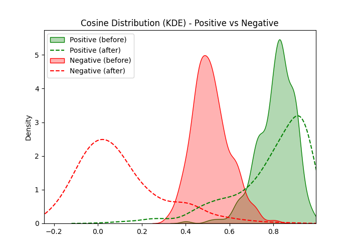
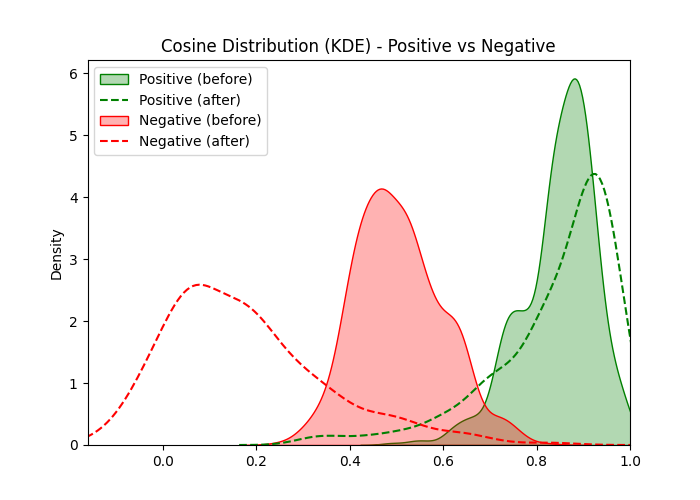

# 📄 Document Intelligence & Representation Learning Pipeline


**Fine-tuned `Qwen3-Embedding-0.6B` on 8 million proprietary legal statutes using contrastive triplet loss, yielding a +0.20 improvement in clustering F1 on semantically similar document pairs. Scaled inference across the full corpus to produce actionable semantic groups via FAISS K-Means and HDBSCAN.**

---

## 🔒 Data Privacy & Compliance Notice

> The training corpus consists of **8 million proprietary legal statutes** sourced from a state-law research archive. Raw text cannot be shared publicly due to data-use agreements and compliance requirements.

This repository implements a **mock data strategy** that faithfully mimics the pipeline mechanics without exposing any real corpus content:

- `src/generate_mock_data.py` produces synthetic statute-like text pairs using topic-aligned templates drawn from real legislative domains (Health, Education, Government Operations, Environment, etc.)
- Mock pairs reproduce the **boundary-sampling mechanics** of the real pipeline: cosine similarity bins (q40–q100), BM25-retrieved hard negatives, and ordinal judge scores calibrated to mirror the real label distribution
- All training, inference, and clustering scripts run end-to-end on the mock dataset with no modification
- Real results reported in this README were produced by running the full pipeline on the proprietary corpus on an institutional HPC cluster

---

## 🏗️ Architecture & Pipeline Overview

```
┌─────────────────────────────────────────────────────────────────────────────┐
│                    Document Intelligence Pipeline                           │
└─────────────────────────────────────────────────────────────────────────────┘

  ┌──────────────────┐
  │  Raw Corpus      │  8M legal statutes across 50 US states
  │  (proprietary)   │  Deduplicated, topic-classified (8 domains)
  └────────┬─────────┘
           │
           ▼
  ┌──────────────────────────────────────────────────────────────────────────┐
  │  Stage 1 — Contrastive Pair Mining                  src/data_pipeline.py │
  │                                                                          │
  │  ┌─────────────────────────┐   ┌──────────────────────────────────────┐  │
  │  │  BM25 (bm25s) Mining    │   │  Random Within-Topic Sampling        │  │
  │  │                         │   │                                      │  │
  │  │  • One index per topic  │   │  • 2.5M random within-topic pairs    │  │
  │  │  • 5% anchors per topic │   │  • Different-state pairs only        │  │
  │  │    (floor: 1K/topic)    │   │  • Deduplication (order-invariant)   │  │
  │  │  • Top-100 per anchor   │   │                                      │  │
  │  │  • Different-state only │   └──────────────────────────────────────┘  │
  │  └────────────┬────────────┘                         │                   │
  │               └──── merge + deduplicate (BM25 priority) ────────────────┘│
  │                                        │                                 │
  │                                        ▼                                 │
  │               Per-topic percentile cosine bins (q40–q95)                 │
  │               Pairs below 40th percentile of topic → excluded            │
  │                                        │                                 │
  │                    Stratified sampling from 10 strata → 100K pairs       │
  │           BM25 × {q40_60, q60_80, q80_90, q90_95, q95_100}              │
  │         Random × {q40_60, q60_80, q80_90, q90_95, q95_100}              │
  └──────────────────────────────────┬───────────────────────────────────────┘
                                     │
                                     ▼
  ┌──────────────────────────────────────────────────────────────────────────┐
  │  Stage 2 — LLM-as-a-Judge Scoring                   src/data_pipeline.py │
  │                                                                          │
  │  Model: gpt-4.1-mini  |  Concurrency: 35 workers  |  Scores: 1–8        │
  │                                                                          │
  │   1-3 → Positive (related)    4-7 → Negative (unrelated)   8 → N/A      │
  │                                                                          │
  │  Exponential backoff retry  |  Checkpoint every 20K rows                 │
  └──────────────────────────────────┬───────────────────────────────────────┘
                                     │
                                     ▼
  ┌──────────────────────────────────────────────────────────────────────────┐
  │  Stage 3 — Hybrid Contrastive + Triplet Fine-Tuning         src/train.py │
  │                                                                          │
  │  Base model: Qwen3-Embedding-0.6B (595M params)                          │
  │  Objective 1: WeightedContrastiveLoss  |  margin=0.7  |  batch=8        │
  │  Objective 2: TripletLoss (cosine)     |  margin=0.5  |  batch=32       │
  │  Two objectives interleaved via model.fit(train_objectives=[...])        │
  │  Triplets: on-the-fly construction with transitive inference             │
  │  Hard negatives selected by descending cosine rank                       │
  │                                                                          │
  │  ┌──────────────────────────┐   ┌──────────────────────────────────────┐  │
  │  │  SLURM Array Job         │   │  Evaluation                          │  │
  │  │  24 tasks × 1 GPU        │   │  Per-topic binary F1 on held-out     │  │
  │  │  RTX 4090 × 32GB         │   │  validation pairs                    │  │
  │  │  Institutional HPC       │   │  Best checkpoint selection           │  │
  │  └──────────────────────────┘   └──────────────────────────────────────┘  │
  └──────────────────────────────────┬───────────────────────────────────────┘
                                     │
                                     ▼
  ┌──────────────────────────────────────────────────────────────────────────┐
  │  Stage 4 — Corpus-Scale Inference                       src/inference.py │
  │                                                                          │
  │  8M statutes processed in 24 SLURM shards                                │
  │  CUDA OOM retry: halves batch size on failure                            │
  │  Output: zstd-compressed parquet, Arrow fixed-size-list embeddings       │
  └──────────────────────────────────┬───────────────────────────────────────┘
                                     │
                                     ▼
  ┌──────────────────────────────────────────────────────────────────────────┐
  │  Stage 5 — Semantic Clustering                           src/cluster.py  │
  │                                                                          │
  │  Approach 1 — FAISS K-Means (no dim reduction)                           │
  │    Raw 1024d embeddings  →  FAISS K-Means, K swept per topic             │
  │    Best K selected by silhouette score; exhaustive partition              │
  │                                                                           │
  │  Approach 2 — Dim-reduced HDBSCAN                                        │
  │    PCA (1024d → 50d)  →  UMAP (50d → 5d, min_dist=0.0, metric=cosine)   │
  │    → HDBSCAN (min_cluster=15)  → noise reassigned to nearest centroid    │
  └──────────────────────────────────────────────────────────────────────────┘
```

---

## 🔬 Architecture Deep Dive

### 1. Contrastive Pair Mining

Naïve random sampling produces easy negatives that carry weak training signal.
The pipeline mines **hard negatives** — statutes that are lexically similar but
semantically distinct — using `bm25s` BM25 retrieval per topic.

```
For each topic domain T:
  anchors ← sample(members_T, frac=max(0.05, floor=1000))
  For each anchor a (different-state pairs only):
    candidates ← bm25s_index_T.top_k(a, k=100)

2.5M random within-topic pairs (different-state only)

Merge + deduplicate (BM25 priority)

cosine_scores ← base_model.encode(all_pairs)
Per-topic percentile bins (thresholds computed within each topic):
  q40_60 | q60_80 | q80_90 | q90_95 | q95_100
  Pairs below 40th percentile of their topic → excluded

Stratified sample → 100K pairs:
  strata = BM25 × 5 bins + random × 5 bins (10 total)
  weights concentrate on q80_90, q90_95, q95_100 (hard boundary cases)
```

Key design decisions:
- **Same-state exclusion**: pairs from the same US state are discarded — cross-state pairs test generalisation rather than near-duplicate matching
- **Per-topic percentile bins**: thresholds are computed within each topic so the bin boundaries reflect each topic's distribution, not a global absolute threshold
- **Stratified weight matrix**: higher cosine bins (q80_90 and above) receive more weight — these pairs sit near the positive/negative decision boundary and carry the most useful gradient signal

---

### 2. Hybrid Contrastive + Triplet Loss

Training uses two interleaved objectives via `model.fit(train_objectives=[...])`:

**Objective 1 — WeightedContrastiveLoss (margin = 0.7)**
```
L(a, b, y, w) = w × 0.5 × [y × d(a,b)²  +  (1-y) × max(0, margin − d(a,b))²]

where  d(a, b) = 1 − cos(a, b)   and   y ∈ {0, 1}
```
Per-score sampling multipliers `{1: 4.0, 2: 2.0, 3: 0.5, 4: 0.2, 5: 0.2, 6: 1.0, 7: 4.0}`
upweight hard/informative examples. Score 4 (boundary) is included as a hard
training negative with low weight; it is excluded from the evaluation metric.

**Objective 2 — TripletLoss (cosine distance, margin = 0.5)**
```
L(a, p, n) = max(0,  d(a, p)  −  d(a, n)  +  margin)

where  d(x, y) = 1 − cos(x, y)   and   margin = 0.5
```

**Triplet construction** uses transitive inference: if the scored pair table
establishes (A ↔ B) as positive and (A ↔ C) as negative, the triplet (A, B, C)
is valid without requiring a direct (B, C) judgment. This multiplies the effective
triplet count from the labeled pairs without additional API calls.

**Hard-negative selection**: within each anchor's negative pool, candidates are
sorted by descending cosine similarity — the most confusable negatives are
presented first, keeping gradients informative throughout training.

Both losses call `model(sentence_features[i])["sentence_embedding"]` — the
differentiable forward path through the transformer. Using `model.encode()` in
a training loop is a fatal bug: it runs under `torch.no_grad()` and
`loss.backward()` becomes a no-op.

---

### 3. Two-Approach Semantic Clustering

After fine-tuning, the full 8M-statute corpus is embedded in parallel across
24 SLURM shards. Two independent clustering pipelines are run on the resulting
embedding matrix:

**Approach 1 — FAISS K-Means** (`pipeline_kmeans`):
```
Raw 1024d embeddings  →  FAISS K-Means, K swept per topic
                          Best K selected by silhouette score
```
- **No dimensionality reduction**: K-Means operates directly on the 1024d Qwen3 embeddings; the distances are already meaningful in that space
- Run **per topic domain** — one K-Means per primary policy topic; K is swept over `[1, 2, 4, 8, 16, 32, 64, 128, 256, 512]` and the best K is selected by silhouette score
- FAISS K-Means with GPU acceleration handles each topic in seconds; sklearn fallback for small topics (<2000 statutes)
- Exhaustive partition: every document is assigned to exactly one cluster

**Approach 2 — Dim-reduced HDBSCAN** (`pipeline_hdbscan`):
```
1024d  →[PCA]→  50d  →[UMAP, metric=cosine, min_dist=0.0]→  5d  →[HDBSCAN]→  clusters
                                                                    noise → nearest centroid
```
- **PCA → UMAP required**: HDBSCAN degrades significantly above ~20 dimensions; reducing to 5d via UMAP (with PCA to 50d first for speed) is the standard fix
- `min_dist=0.0` produces tight local structure that sharpens HDBSCAN's cluster boundaries
- Run **per topic domain** — one HDBSCAN per primary policy topic
- Noise points (`-1`) are **reassigned to their nearest cluster centroid** so the final output is also an exhaustive partition, matching the K-Means contract
- Finds variable-density and irregular-shaped clusters that K-Means cannot capture

**Shared components:**
- `evaluate_clusters()` — same pairwise classification F1 metric for both approaches
- PCA and UMAP primitives (`reduce_pca`, `reduce_umap`) shared across pipelines

---

## 📊 Results

### Hyperparameters

| Parameter | Value |
|---|---|
| Base model | `Qwen/Qwen3-Embedding-0.6B` |
| Embedding dimension | 1024 |
| Loss 1 | WeightedContrastiveLoss (cosine distance) |
| Contrastive margin | 0.7 |
| Contrastive batch size | 8 |
| Loss 2 | TripletLoss (cosine distance) |
| Triplet margin | 0.5 |
| Triplet batch size | 32 |
| Learning rate | 2e-5 |
| Epochs | 3 |
| Warmup steps | 100 |
| Optimizer | AdamW |
| Training pairs | ~100K labeled pairs → ~300K triplets |
| Hardware | 1× RTX 4090, 32 GB VRAM |
| HPC cluster | Institutional HPC cluster (SLURM array, 24 tasks) |

### Dimensionality Reduction & Clustering

**Approach 1 — FAISS K-Means (`pipeline_kmeans`)**

| Stage | Input dim | Output dim | Method |
|---|---|---|---|
| FAISS K-Means | 1024 | K swept per topic | K ∈ {1,2,4,8,16,32,64,128,256,512}; best K by silhouette |

**Approach 2 — Dim-reduced HDBSCAN (`pipeline_hdbscan`)**

| Stage | Input dim | Output dim | Method |
|---|---|---|---|
| PCA | 1024 | 50 | sklearn PCA |
| UMAP | 50 | 5 | `n_neighbors=15`, `min_dist=0.0`, cosine metric |
| HDBSCAN | 5 | variable | `min_cluster_size=15`, `min_samples=None` (→ min_cluster_size), `cluster_selection=eom` |
| Noise reassignment | — | — | Noise points (-1) → nearest cluster centroid |

### Performance

> **Historical research results — proprietary corpus only.** The numbers below
> were produced by running the full pipeline on the institutional HPC cluster
> against the 8M-statute corpus. They cannot be independently reproduced from
> this public repository because the training corpus is not included. `src/experiment.py`
> provides a synthetic demo that verifies gradient flow and metric correctness on
> mock data; its output should not be compared to these figures.

| Model | Pairwise Classification F1 | Notes |
|---|---|---|
| `Qwen3-Embedding-0.6B` (base) | 0.61 | Zero-shot, no fine-tuning |
| `Qwen3-Embedding-0.6B` (fine-tuned) | **0.81** | Trained on 8M-statute contrastive pairs |
| **Δ improvement** | **+0.20** | On held-out labeled pairs, proprietary corpus |

**Cosine similarity distributions before and after fine-tuning** (two representative topics, proprietary corpus):

| Health | Government Operations |
|:---:|:---:|
|  |  |

Filled = before fine-tuning; dashed = after. Green = positive pairs (similar statutes), red = negative pairs (dissimilar). After training the distributions separate cleanly — positives shift right toward cosine ≈ 0.9 and negatives shift left toward ≈ 0.0. `train.py` generates an equivalent plot for any run at `runs/<name>/task_00/visualization/cosine_kde.png`.

### Validation Methodology

Evaluation is implemented in `src/evaluate.py`. Several design decisions are non-obvious:

**Prediction rule — cluster membership as binary similarity**

Two documents are predicted similar if and only if they share the **same K-Means cluster label**
(and that label ≠ −1). This is a deliberate choice: the downstream use case is semantic grouping
(documents are routed to groups, not ranked pairwise), so the metric is measured at clustering
granularity — not cosine similarity threshold.

**Score inclusion / exclusion**

| LLM-judge score | Meaning | Role in evaluation |
|---|---|---|
| 1, 2, 3 | Related / similar statutes | Ground-truth **positive** |
| 4 | Borderline (annotator uncertainty) | **Excluded** |
| 5, 6, 7 | Unrelated / dissimilar statutes | Ground-truth **negative** |
| 8 | N/A (off-topic pair) | **Excluded** |

Score 4 is excluded because the LLM judge rubric places it explicitly at the decision boundary
— pairs with score 4 carry genuine annotator uncertainty and would add noise to both precision
and recall if included. Score 8 marks pairs the judge could not evaluate (e.g. one statute is
a procedural header with no semantic content).

**K-selection protocol — train/test split**

```
All labeled pairs (scores 1–3, 5–7)
        │
        ├── 80% → train split  ← K is swept here (K ∈ {5, 10, …, 150})
        │                         Best K = argmax train_F1 (ties: larger K)
        │
        └── 20% → test split   ← Held out until after K is chosen
                                  Final reported F1 is TEST F1
```

Sweeping K on the full dataset and then reporting F1 on the same dataset inflates results:
K-Means will find a partition that memorises the structure of the labeled pairs. Selecting best K
on the train split only and evaluating on the **held-out test split** is the correct protocol
— it tests whether the learned clusters generalise to unseen labeled pairs.

The +0.20 F1 figure in the Performance table is the test-split F1 of the fine-tuned model
minus the test-split F1 of the base model, at their respective best-K values, evaluated on
the proprietary corpus.

---

## 🚀 Quick Start

**1. Generate mock data** (no external dependencies required):

```bash
pip install -r requirements.txt
python src/generate_mock_data.py
# → data/mock_pairs.jsonl (~200 anchor-centric statute pairs)
# Each anchor has both positives (score 1–3) and negatives (score 5–7)
# so that triplet construction produces non-zero training examples.
```

**2. Run the smoke tests** (no GPU or model download required):

```bash
pytest tests/ -v -k "not slow"
```

**3. Fine-tune on mock triplets**:

```bash
python src/train.py \
  --triplets data/mock_pairs.jsonl \
  --output   runs/mock_run \
  --epochs   1 \
  --batch-size 4
```

**4. Extract embeddings and cluster**:

```bash
python src/inference.py \
  --input  data/mock_pairs.jsonl \
  --output embeddings/mock \
  --shard 0 --n-shards 1

python src/cluster.py   # end-to-end mock run with random embeddings
```

**5. Baseline vs. fine-tuned experiment (synthetic demo)**:

```bash
python src/experiment.py \
  --pairs  data/mock_pairs.jsonl \
  --output runs/experiment \
  --epochs 2
# Note: results are from synthetic data; see Performance section above.
```

**HPC (full corpus)** — submit the SLURM array job:

```bash
sbatch run_hpc_job.slurm
# 24 array tasks × 1× RTX 4090 × 1h wall time
# Stages: prepare → score → train → inference → cluster
```

---

## 📁 Repository Structure

```
finetune_example/
│
├── README.md                   ← You are here
├── requirements.txt
├── run_hpc_job.slurm           ← Multi-stage SLURM array orchestrator
│
├── data/
│   ├── mock_pairs.jsonl        ← Synthetic statute pairs (generated)
│   └── mock_config.json        ← Sampling & training hyperparameters
│
├── tests/
│   ├── test_triplets.py        ← Triplet construction (zero-triplets regression)
│   ├── test_metrics.py         ← Pairwise F1 metric correctness
│   ├── test_gradient.py        ← Gradient flow verification (slow, requires model)
│   └── test_smoke.py           ← End-to-end pipeline smoke tests
│
└── src/
    ├── generate_mock_data.py   ← Self-contained mock data generator
    ├── data_pipeline.py        ← BM25 mining + async LLM-as-judge scorer
    ├── train.py                ← Qwen3-0.6B contrastive triplet training
    ├── inference.py            ← Shard-based embedding extraction
    ├── cluster.py              ← FAISS K-Means + HDBSCAN + PCA/UMAP
    ├── evaluate.py             ← Pairwise classification F1 (K sweep, train/test split)
    └── experiment.py           ← Synthetic baseline vs. fine-tuned demo
```

---

## 📄 License

MIT
